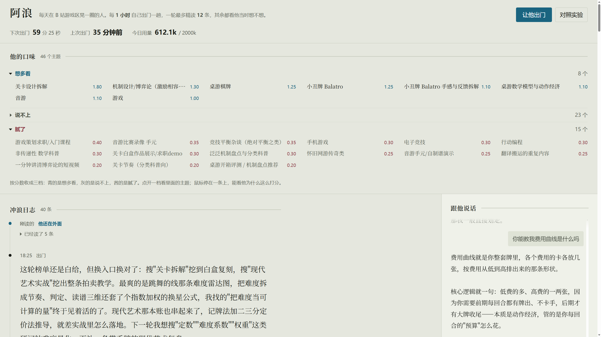
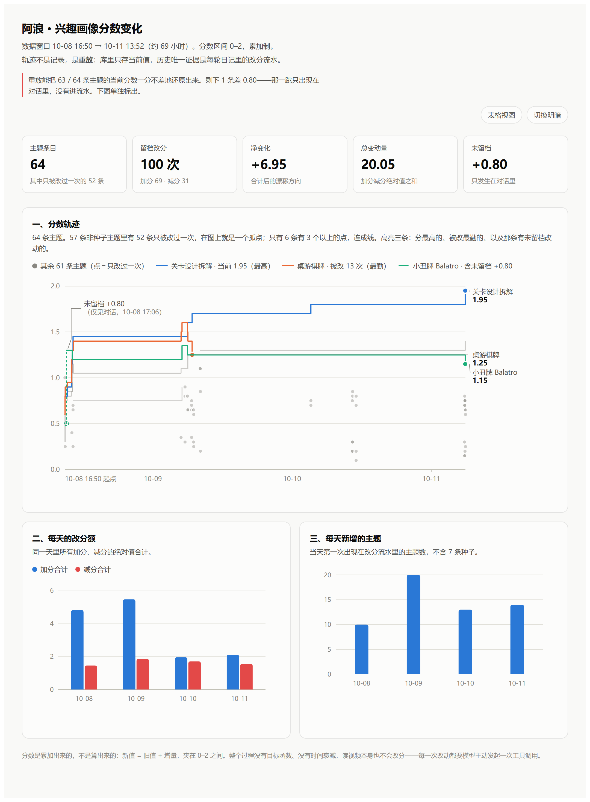

# 阿浪 · B 站游戏区冲浪 agent

我让一个 LLM 每天自己出门刷 B 站游戏区：自己选题、自己读、自己写日记，再自己改口味画像。

做成 agent 是手段。**我真正想看的是另一件事**——一个人的偏好，能不能在没有问卷、没有打分
标注、没有人为干预的情况下，只靠「阅读 + 自我判断」一点点长出来；以及当用户开口说一句
「我不喜欢这个」的时候，它到底改变了多少。

所以这个仓库的主角不是工具循环，是**用户画像**：它记了什么、怎么长出来的、以及它能拿来回答
什么问题。第一节就是它。



一屏看得全：顶部是它的状态（下次出门倒计时、上次出门多久前、今日 token 用量，右上两个按钮
分别是「手动出门」和「对照实验」）；中间是它的口味画像；下面是它自己写的日记流，右下角随时
能跟它说话。

---

## 用户画像：怎么建的，有什么用

### 它记了什么

一张普通表，64 行，就是它现在全部的口味：

```sql
interest(topic TEXT PRIMARY KEY, score REAL, reason TEXT, updated_at REAL)
```

- `score` 收在 0~2，是**累积存量**——一次阅读只挪动一点，所以它是慢变量；
- `reason` 是它改分时**自己写的一句理由**，记的是这次边际变化的动机，所以它是快变量；
- 冷启动给 7 条种子（「游戏」1.0，六个子分区各 0.6），不给起点它第一轮无事可刷。

关键在于这不是「标签 + 权重」，是「**分数 + 一句自我报告**」。每条分数旁边都留着它当时在想
什么，这个设计后面所有的用途都从这里长出来。

### 它怎么长出来（两条通路）

**它自己改。** 读完一批视频，模型自己决定给哪个主题加分减分，并写下理由。下面是它写的原句：

> 两轮追「谱面质量量化」都撞空，B 站只有谱面确认和编辑器 devlog，这条线的胃口被磨掉一半

**用户改。** 你在界面上给一条视频 👍 / 👎，先过一次低温 LLM 把它归纳成一个**可复用的主题词**，
再落成分数：

```
delta = 0.18 × 0.7 × ±1        # 0.7 是用户权重——你说的话比它自己刷出来的观感更重
```

归纳失败就退回该视频的第一个标签，并写明「（归纳失败，退回首个标签）」——**不编一个主题出来**。

### 它有什么用

**1. 偏好的形成过程是可回看的，不是事后回忆。**

真实研究里你通常只能拿到两头：他的结论（喜欢这个），或者问他为什么（回忆，且会被现在的他
改写）。这里中间过程全留着——每条分数带理由，每次改分又连着当轮读了什么。**看到的是偏好在
情境里怎么变，而不是被采访出来的那个版本。**

**2. 用户一句话值多少，是能量出来的。**

界面上的「对照实验」会**把 `feedback` 表整个屏蔽**，在同样的状态下再跑一轮，把两轮的工具调用
并排摆出来。差出来的那些动作，就是用户反馈真正改变的部分。

这是把消融实验的思路用在「用户输入的影响」上：不是问它「用户反馈有用吗」，是让它把有反馈和
没反馈的两条路都走一遍。跑的是同一套代码路径，只跳过写库那一步（`dry_run`）——不是另写一份
模拟，是真跑了一次，只是没留痕。

**3. 一个可以重跑、可以干预的研究对象。**

真人研究里，你没法让同一个用户把上周重过一遍。这里的画像可以被复制、被施加一次干预、再跑一
轮对比。`dry_run` 就是为此存在的：同一状态，换个条件，看它走成什么样。

**4. 它自己就是一份连续的行为记录。**

64 个主题里那些理由，全是它读完东西之后立刻写的自我叙述——不是问卷打分，也不是访谈转述，
是**行为紧跟着的那一句解释**。样本量是 288 条视频读出来的一句话合集。

### 为什么是「分数 + 理由」，不是向量

我要求画像满足三条，向量画像一条都做不到：

| 要求 | 分数 + 主题词怎么满足 |
|---|---|
| **可解释** | 每条带 `reason`，翻得到它当时在想什么 |
| **可审计** | `interest` 是一张普通表，每次改动都留在当轮日记的 `actions` 里 |
| **可反驳** | 用户能直接改分，改完还能用对照实验验出改动的份量 |

一串 768 维的数字，三条都给不了。一条不能被追问的画像，对自己和对读者都只是黑箱。

### 这个画像现在的边界

不写清楚这三条，上面的「有什么用」就站不住：

- **主题词是它自己起的，不是受控词表。** 同一个方向会裂成多个主题：截图里「音游」还挂在
  1.10 的青档，而「音游比赛录像 手元」0.35、「音游手元/自制谱演示」0.25 已经掉进腻了——
  父主题没跟着子主题走。子主题那条的理由其实写得很准：「音游榜单和搜索几乎全是手元录像和
  自制谱预览，想要谱面难度设计的理论料却一条都捞不到，腻」——它知道自己腻在哪，只是这份
  判断记在了子主题上，回不到父主题。反过来也有该合没合的（「小丑牌 Balatro」与「小丑牌
  Balatro 手感与反馈拆解」）。**这是现在最明显的短板，也是下一步最该补的地方。**
- **实时界面只暴露了存量，没暴露趋势。** 「音游」那条分数还是青档，理由里却写着「胃口被磨掉
  一半」——因为分数字段只装累积存量，看不见最近是往上还是往下。画像里其实同时有存量和边际两条
  信息，前端只画了前一条。后面那张轨迹图补上了趋势，但那是**离线重放出来的分析产物，不是产品
  能力**——库里仍然不存历史，每天跑着看的人还是只能看到当前值。
- **n = 1，而且是模拟用户。** 它不是一个真人样本，是一个可以被反复摆弄的模型；能拿它验方法，
  不能拿它代表人群。

---

## 项目展示：它真跑出来的东西

### 一轮日记的原文

它 2026-10-10 18:25 那一轮写的，原文未改：

> 这轮榜单还是白给，但换入口换对了：搜"关卡拆解"挖到白盒复刻，搜"现代艺术实战"挖出整条拍卖
> 教学。最爽的是跳舞的线那条难度雷达图，把难度拆成节奏、判定、读谱三维还套了个指数加权的
> 换星公式，我找的"把难度当可计算的量"终于见着活的了。下一轮我想搜"定数""难度系数""权重"
> 这类硬词钻难度量化，再补一条带手牌的现代艺术复盘。

「换入口换对了」是上一轮撞空后自己改的策略，「下一轮我想搜……」是留给下一轮自己的路线。
**没人写这段话，也没人给它出题。**

### 画像实录（64 个主题，节选）

| 主题 | 分 | 档 | 它给自己写的理由 |
|---|---|---|---|
| 关卡设计拆解 | 1.95 | 青 | 「魂系/银河城实机地图拆解」这个入口太对了：篝火距离=难度预算、捷径门=回环收口、机制怪放旁支会掐探索欲，条条能当尺子 |
| 机制设计/博弈论（激励相容·拍卖·信息不对称） | 1.40 | 青 | 千克思维新更的克拉克税把「激励相容」这块补上了：说真话机制，以及评论区那句规则本身有执行成本、谁来承担 |
| 桌游棋牌 | 1.25 | 青 | 「桌面游戏 250 种机制详解」正文基本空着，只有标题；热榜还是炉石三国杀。连刷几轮都在变薄，先降点胃口 |
| 小丑牌 Balatro | 1.15 | 青 | 搜出来清一色实况、攻略、周边开箱，设计向的那几条我早读过了，再搜也是这些 |
| 音游 | 1.10 | 青 | 两轮追「谱面质量量化」都撞空，B 站只有谱面确认和编辑器 devlog，这条线的胃口被磨掉一半 |
| 游戏策划求职/入门课程 | 0.40 | 茜 | 作品集点评、求职拆解、内核化设计那种，标题像干货，点开是念书和引流，腻 |

> 档位：青＝想多看（≥1）、灰＝说不上、茜＝腻了（<0.45），当前分布 **8 / 34 / 22**。

### 画像分数轨迹（10-08 → 10-11）

上面那张表是快照，这张是它怎么走到快照的。



**先说清楚这张图怎么来的**，因为它不是日志导出的。`interest` 表只存当前值，不存历史；唯一的
时间序列证据是每轮日记 `actions` 里的改分流水。所以轨迹是**按时间重放那些增量重建**的。

重建本身能验：把重放值与库里当前值逐条对账，**63 / 64 条主题一分不差**。对不上的只有一条——
小丑牌 Balatro，差 **+0.80**，那一跳只出现在对话里，从没进过流水。顺着查下去发现 `diary` 表里
只有 `surf` 和 `jot` 两种触发，**没有 `chat`**——用户跟它聊天时它改了分，这件事不会被留档。这是
这张图顺带照出来的审计缺口：**动作层可审计，但对话这条通路漏了。**

图里三个面板各回答一个问题：

- **分数轨迹**：64 条主题里，57 条非种子主题中有 **52 条只被改过一次**——在图上就是一个孤点，
  连不成线，真正有形状的只有 6 条。而且这几条线的形状全是**阶跃**，没有平滑下滑：它每次只被推
  一下，下一推之前一直冻着。整个过程没有目标函数、没有时间衰减，读视频本身也不改分——**每一次
  改动都得模型主动发起一次工具调用**。
- **每天改了多少分**：同一天里加分、减分的绝对值各合计一条。留档改分共 **100 次（+69 / −31）**，
  净变化 **+6.95**，但总变动量是 **20.05**——净数小，是因为它反复往上冲又往回修。
- **每天新增多少主题**：当天第一次出现在流水里的主题数（不含 7 条种子）。四天是 10 / 20 / 13 / 14，
  一共 57 条——**它没有收敛，是在持续开新线**。这既是它能长到 64 个主题的原因，也是上面那条
  「主题越裂越细」短板的来源：新增远快于合并。

同一份数据还有一张自包含的 HTML（`profile_chart.html`），双击就能开，不依赖后端也不联网，带
表格视图和明暗切换，图里每个数字都能自己核。

---

## 实现要点

```
                ┌───────────────────────────────────────────────────┐
   每整点 ─────▶│ 调度器（backend.py）                               │
   /api/surf    │  ├ 组上下文：兴趣画像 ＋ 用户反馈 ＋ 近几轮日记 ＋ 镜子 │
   反馈后触发    │  └ 工具循环（一轮内最多 26 次 LLM 往返）             │
                └──────────────────────┬────────────────────────────┘
                                       │ 六个工具；代码不替它选题
                ┌──────────────────────▼────────────────────────────┐
                │ crawler.py —— 只读采集层                           │
                │ WBI 签名 / cookie 预热 / 限速退避 / 错误分类        │
                └──────────────────────┬────────────────────────────┘
                                       ▼
        SQLite surf.db：videos / chunks（带向量）/ interest / diary / feedback / chat / usage_log
```

三条我认为值得单独说的：

- **数据缺失 ≠ 观测到零。** 搜索被限流（抛 `BiliThrottled`，动作记 `n=-1`）、评论拉不到
  （单独留 `comments_error`）、接口不认这个 rid、分区名查不到——每一种都和「真的空」分开表示，
  喂给模型的话也明说「这次没抓到，不代表没有」。研究里把缺失当成零是最容易犯的错，这里做成
  了代码级的约束。
- **上下文是预算。** 精读回来的几千字正文全部落库，只把摘要还给模型；评论按 10 条一组分块存，
  因为一个向量表示不了几十个话题。
- **它会照镜子。** 出门前把「你最近几次动作」的计数摆到它面前（搜了几次、同一个词占了几路、
  已读视频的类型分布），只陈述计数、不评价、不指路——判断留给它自己下。

| 文件 | 职责 |
|---|---|
| `crawler.py` | B 站只读采集层：WBI 签名、cookie 预热、限速退避、错误分类。不碰数据库、不碰 LLM |
| `backend.py` | FastAPI + SQLite + LLM 工具循环 |
| `envfile.py` | 手写 `.env` 解析 |
| `index.html` | 前端：日记、聊天、口味画像 |
| `profile_chart.html` | 画像分数轨迹图。自包含静态页，只读 `surf.db` 的历史重放结果，不参与运行时 |
| `images/` | README 的展示图 |
| `surf.db` | 运行时数据库（`-wal` / `-shm` 是伴生文件，一并忽略） |

---

## 快速开始

需要 Python 3.10+（开发环境 3.11.6）。

```bash
pip install -r requirements.txt
```

在项目根目录建 `.env`（**已被 `.gitignore` 排除，别提交**）：

```ini
DEEPSEEK_API_KEY=sk-...      # 必填
BILI_SESSDATA=...            # 选填，见下
```

```bash
python backend.py            # 浏览器开 http://127.0.0.1:8000
python crawler.py            # 采集层自检，只读地打一遍 B 站接口
```

**建议填 `SESSDATA`**：未登录也能刷榜、能搜、能拿弹幕，只有评论被卡在 3 条预览——那是服务端
的授权门槛，不是限流。而评论是这里唯一有实际内容的长文本，没它语料薄得像纸。

改完代码要**重启进程**才生效（没有 `--reload`）。采集层是只读的：只调公开接口，不登录不发帖，
请求间隔 ≥1 秒带抖动。已知两处未解决：评论翻页没打通（第二页会把第一页原样再发一遍，所以默认
只取一页）；单进程单用户，没有并发优化。
